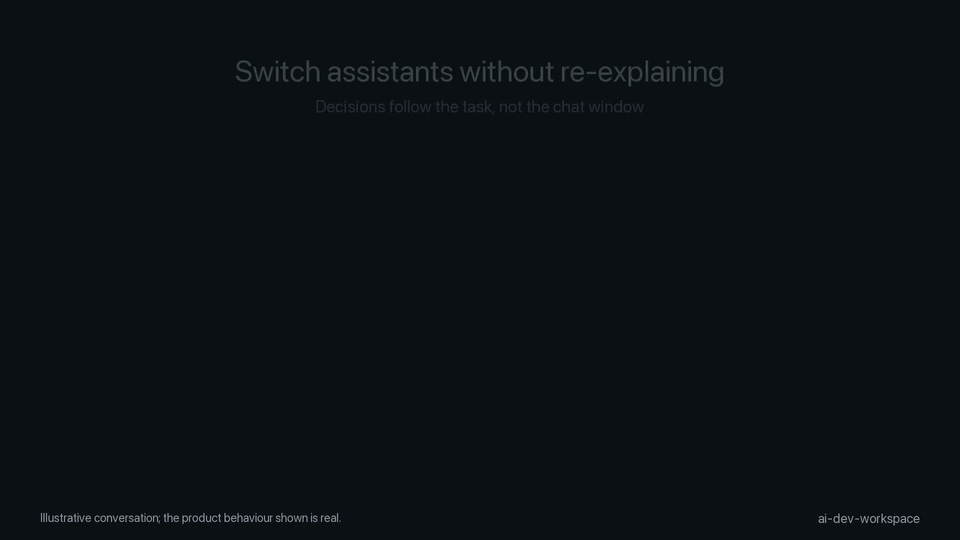

# AI Dev Workspace

**Handoffs you can verify.** When an assistant stops, the next one (any vendor, any day) starts from a handoff with what was done, what was decided, the evidence you recorded and what not to retry. No background AI; plain Markdown you own.

[](https://pypi.org/project/ai-dev-workspace/) [](https://github.com/Alenroyfeild/ai-dev-workspace/actions) [](https://www.python.org/) [](LICENSE)

<!-- Demo GIF -->


## Quick start

```bash
pipx install ai-dev-workspace --pip-args='--pre'  # beta; omit --pip-args after a stable release
cd ~/code/myapp && ws start
```

`ws start` previews every file and writes nothing until you confirm. No pipx? `brew install pipx`, or `python3 -m venv ~/.ws && ~/.ws/bin/pip install --pre ai-dev-workspace`; put its `bin` directory on `PATH` first. Try it offline first with `ws demo`, or follow the [5-minute tutorial](docs/TUTORIAL.md).

## The 5 commands

| Command | What it does |
|---|---|
| `ws start` | Connect this repo to private memory outside the checkout; previews first |
| `ws remember "<decision>"` | Save one decision or correction in your claimed task |
| `ws checkpoint --status in_progress --next "<exact next step>"` | Save status and the exact next step |
| `ws brief` | Print the task memory: decisions, next action, blockers, `Do not redo:`; the session-start hook runs it for you |
| `ws start --undo` | Remove the repo wiring again; private memory is kept |

Full list: [CLI commands](docs/COMMANDS.md).

- **Switch Claude Code ↔ Codex mid-task:** save a checkpoint, then continue with a bounded brief from the saved task memory; client context can differ ([guide](docs/guides/share-memory-claude-code-codex.md)).

## Results

Measured in [`bench/README.md`](bench/README.md) across independent paired investigations (Codex `gpt-6-luna`, n=5 per cohort):

| Arm | Pass (October 11) | Pass (October 10) |
|---|---|---|
| Fresh baseline (no memory) | 0/5 | 0/5 |
| Workspace (automatic brief) | 2/5 | 1/5 |
| Plain Markdown handoff | 5/5 | 4/5 |

The latest controlled runs show the plain Markdown handoff beating the workspace (5/5 and 4/5 against 2/5 and 1/5), with the automatic-capture release gate still unmet. The win for the workspace is structure, cross-assistant handoff, and avoiding manual file management. Details and earlier runs: [bench/README.md](bench/README.md) and [docs/MEASUREMENTS.md](docs/MEASUREMENTS.md).


## Compatibility

| Assistant | Status | Test proof |
|---|---|---|
| Claude Code | supported, tested live on macOS | CI-tested |
| Codex | supported, tested live on macOS | CI-tested |

Everything else is untested live: Cursor, Copilot (VS Code), Gemini CLI and Antigravity have fixture tests only; Linux and Windows are CI-tested only. Reports welcome through [Something broke](https://github.com/Alenroyfeild/ai-dev-workspace/issues/new?template=bug.yml). Details: [Experimental features](docs/EXPERIMENTAL.md) and [client verification](docs/CLIENT-VERIFICATION.md).

## Update, plugin and videos

Updating? `ws update` updates the ws software (a package install prints the `pipx upgrade` command instead). Then `ws upgrade --dry-run` previews managed private-workspace updates and `ws upgrade --yes` applies them. Then run `ws start` in each repo to refresh its wiring. Running assistant sessions and MCP servers keep the old code until you start a new session or reload MCP connections.

Prefer a Claude Code plugin? Preview. Not yet listed in Anthropic's official plugin directory; install from our GitHub marketplace:
```text
/plugin marketplace add Alenroyfeild/ai-dev-workspace
/plugin install ai-dev-workspace@ai-dev-workspace
```
Live-checked on beta.7 (2026-11-05). See the [plugin preview](docs/ADVANCED.md#claude-code-plugin-preview). Generated assistant hooks and configs stay local (`.git/info/exclude`), task memory lives outside the repo in `~/.ai-dev-workspace/<repo-name>`, and `ws start --undo` cleanly removes repo wiring ([remove it](docs/TUTORIAL.md#remove-it)).

<!-- videos:start -->
### Watch (videos for 0.1.0b7)

- [Watch the 2-minute explainer](https://youtu.be/sfcBNSELq-8)
- [Under the hood: real commands, real output](https://youtu.be/ZmwwgYzZUJY)
- Feature shorts: [Switch assistants](https://youtu.be/GAX8Jbl4KqY) · [Resume the next step](https://youtu.be/d4iicMtNq0o) · [Dead ends](https://youtu.be/Pf5JuXsKz98) · [Skills](https://youtu.be/NI69JfxGR_s) · [Team workspace (Preview)](https://youtu.be/-BlKcnaS6yM) · [Guards](https://youtu.be/_jmPEb2wSj4) · [Assistants](https://youtu.be/R6-hfqvz1YA) · [Install as a plugin (Preview)](https://youtu.be/BnbVLSl1vVs) · [Review old lessons](https://youtu.be/mcec1EtTi0A) · [Guards read git's grammar](https://youtu.be/GSZikn9b9qE)
- Earlier editions: [0.1.0b5](https://youtu.be/w5EwQNO8Lz0) · [0.1.0b6](https://youtu.be/sfcBNSELq-8)
<!-- videos:end -->

## Example

```text
Session 1 — You: “Empty email returns missing_email; leave signup unchanged.”
Assistant: “I’ll trace login and keep the decision with this task.”
You: “Save a checkpoint and stop here.”

Session 2 — You: “Continue the login fix.”
Assistant: “The saved note says return missing_email and leave signup unchanged.”
You: “Yes, continue.”
```

## Features

| Feature | Status | What it does | Docs link |
|---|---|---|---|
| Session brief | Stable | Injects bounded task memory at session start; transcript captures are unverified | [Overview](docs/OVERVIEW.md) |
| Decisions & handoffs | Stable | Saves status, next action, and explicit rulings (`ws checkpoint`, `ws remember`); automatic capture is best-effort | [Commands](docs/COMMANDS.md) |
| Dead ends | Stable | Records failed approaches and displays a bounded `Do not redo:` in the brief | [Concepts](docs/CONCEPTS.md) |
| Lessons | Stable | Records cross-task guidance with `ws lesson`; tools should save only when the user asks or approves | [Commands](docs/COMMANDS.md) |
| `ws lesson review` | Stable | Read-only list of lessons with old date stamps (`--days N`); changes or deletes nothing | [Commands](docs/COMMANDS.md#search-and-lessons) |
| MCP server | Stable | Exposes 7 core tools by default; others by name on request via stdio | [MCP](docs/MCP.md) |
| Guards pack | Stable | PreToolUse hook denies risky commands and secrets before execution; beta.7 reads git push option grammar (abbreviations, `--prune`, `--mirror`); a safety net, not a security boundary | [Packs](docs/PACKS.md) |
| `ws demo` | Stable | Creates an isolated sandbox repo to test commands safely | [Tutorial](docs/TUTORIAL.md) |
| Claude Code plugin | Preview | Hooks + MCP + the handoff, pickup, lesson and thinkbeforeact skills; needs CLI + `ws start`; not in Anthropic directory; Windows untested | [Advanced](docs/ADVANCED.md#claude-code-plugin-preview) |
| Native imports | Stable | Reads existing Claude and Codex memory files (`ws import native`) | [Commands](docs/COMMANDS.md#import-existing-memory) |
| Skills packaging | Stable | Format checked; third-party installer not verified; CLI and setup still required | [Skills](docs/SKILLS.md) |
| Compact MCP recall | Stable | Bounded note cards and explicit untrusted detail; CLI snippets unchanged | [Advanced](docs/ADVANCED.md#compact-mcp-recall) |

Not in the 1.0 promise: see [Experimental features](docs/EXPERIMENTAL.md).

## How it works

```text
Claude Code / Codex / Cursor / Copilot / Gemini / Antigravity
        │ (session startup & capture hooks)
        ▼
~/.ai-dev-workspace/<repo-name>/           (private, outside repo)
  ├── workspace.json                       (settings, active task, packs)
  └── vault/
      ├── Tasks/<id>.md                    (status, next action, decisions, blockers)
      └── Learnings.md                     (reusable cross-task lessons & dead ends)
        ▲
        │ (MCP stdio connection: 7 core tools by default; others by name)
  Local Assistant (MCP client)
```

Memory storage makes no background model calls. `ws delegate --run` starts only declared assistant CLIs or sends a redacted brief to an explicitly configured gateway; output is unverified. Task memory is plain Markdown you own.


## Compared with

- **Built-in memory files (CLAUDE.md, AGENTS.md):** Plain instructions per assistant; `ai-dev-workspace` adds cross-assistant handoffs, active task state, and `Do not redo:` constraints.
- **A plain HANDOFF.md:** Works well for manual notes (and beat automatic workspace capture in latest benchmark cohorts: 5/5 vs 2/5); `ai-dev-workspace` adds cross-assistant automation, structured brief injection, and staleness warnings.
- **claude-mem:** Captures tool use through hooks and compresses it with AI into SQLite + vector search ([upstream docs](https://github.com/thedotmack/claude-mem)), providing automatic memory capture without explicit commands; `ai-dev-workspace` keeps explicit Markdown you own, makes no background model calls for memory (explicit delegation can call declared CLIs or a configured gateway), and focuses on durable handoffs with next steps and dead ends ([guide](docs/guides/keep-decisions-without-background-ai.md)).

## Known limits

- **Capture is best-effort:** Explicit CLI commands (`ws remember`, `ws checkpoint`) are deterministic; automatic transcript cue-word capture is best-effort.
- **Guards are a safety net:** Pattern matching blocks common risky commands and secrets in commands or written files, but is not an unbypassable security boundary.

## Privacy & safety

- **Private by default:** Memory is stored outside checkout paths in `~/.ai-dev-workspace/<repo-name>`. Team sharing requires an explicit private repo (`ws team init`) with manual confirmation.
- **Redaction is best-effort:** `ws` masks known API keys, tokens, and private spans (`<private>...</private>`), but does not reliably catch names or amounts. Review previews before sharing; regex redaction does not replace secret hygiene.
- **Network checks:** Session-start notices can check GitHub releases and linked issues about once a day; set `WS_OFFLINE=1` to disable these checks.
- **Guards are a safety net:** The `guards` PreToolUse hook blocks known risky shell patterns and secrets in commands or written files, but it is a safety net, not an unbypassable security boundary.

## Coming next

- **Common Agent Plugins manifest (PLG3):** parked and unavailable until Codex can load the root manifest without losing plugin hooks.
- **Codex plugin MCP through roots (PLG5):** parked and unavailable for Codex; codex-cli 0.155.1 offers no roots and cannot expand plugin MCP paths, so use `ws start` for MCP. Clients that offer roots get the beta.7 Preview.

## Documentation

- **Start:** [5-minute tutorial](docs/TUTORIAL.md) · [Setup guide](docs/SETUP.md) · [Demo walkthrough](docs/DEMO.md) · [Cross-client guide](docs/guides/share-memory-claude-code-codex.md)
- **Use:** [CLI commands](docs/COMMANDS.md) · [Packs catalog](docs/PACKS.md) · [Skills distribution](docs/SKILLS.md) · [MCP server](docs/MCP.md) · [Advanced usage](docs/ADVANCED.md)
- **Guides:** [Keep decisions without background AI](docs/guides/keep-decisions-without-background-ai.md) · [Stop retrying dead ends](docs/guides/stop-retrying-failed-approaches.md)
- **Team:** [Team use](docs/TEAM.md) · [Team workspace setup](docs/TEAM-WORKSPACE.md)
- **Reference:** [Overview](docs/OVERVIEW.md) · [Architecture](docs/ARCHITECTURE.md) · [Benchmark measurements](docs/MEASUREMENTS.md) · [Client verification](docs/CLIENT-VERIFICATION.md) · [Windows support](docs/WINDOWS.md) · [Roadmap](docs/ROADMAP.md)

## Status & contributing

`ai-dev-workspace` is in public beta (v0.1.0-beta.7 on PyPI). Planned improvements are tracked in the [Roadmap](docs/ROADMAP.md). Bug reports and feedback are welcome through [Something broke](https://github.com/Alenroyfeild/ai-dev-workspace/issues/new?template=bug.yml).

Released under the [MIT License](LICENSE). <!-- mcp-name: io.github.Alenroyfeild/ai-dev-workspace mcp-name: io.github.alenroyfeild/ai-dev-workspace -->
